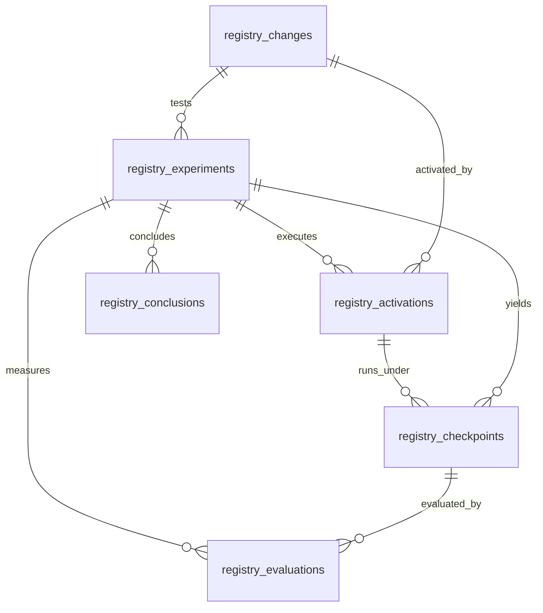

# Experiment and Change Tracking System

## Overview and Purpose

Sheepdog Herding Lab requires rigorous evidence standards for reinforcement learning research ([AGENTS.md](../AGENTS.md)). Previously, `artifacts/training-telemetry.sqlite` logged individual episode completions (`training_episodes`), while changes, hypotheses, evaluations, and conclusions were fragmented across loose JSON files and Markdown handoffs.

The **Experiment and Change Tracking System** extends the SQLite telemetry store with six linked relational tables under `PRAGMA user_version = 1`. This infrastructure provides immutable, auditable lineage connecting every code or hyperparameter modification to the exact running trainer activation, checkpoint, formal evaluation, and evidence-backed conclusion.

---

## The 5 Core Tracking Questions

Every checkpoint and intervention can be queried to answer five foundational questions:

```
[Change] (What changed & why? When implemented?)
   │
   ▼
[Experiment] (Hypothesis, budgets, seed manifests, assistance mode)
   │
   ▼
[Activation] (When did runtime trainer start using it? Status: active/pending_restart)
   │
   ▼
[Checkpoint] (Episode count, label, policy transitions, world steps, SHA-256)
   │
   ▼
[Evaluation & Conclusion] (Success rate, rewards, per-seed results, regression claims)
```

1. **What did we change, and why?**  
   Tracked in `registry_changes` with title, description, category, hypothesis, rationale, git commit, and dirty worktree patch hash.
2. **When was it implemented?**  
   Recorded as an immutable ISO-8601 UTC timestamp in `registry_changes.implemented_at`.
3. **When did the running trainer actually start using it?**  
   Explicitly separated from implementation time in `registry_activations`. Distinguishes disk edits from runtime process execution.
4. **At which training episode, checkpoint, policy transition, and world step?**  
   Tracked with exact counter separation in `registry_checkpoints` and `registry_activations`.
5. **What results followed, and what evidence shows improvement or regression?**  
   Linked formal evaluations in `registry_evaluations` and auditable findings in `registry_conclusions`.

---

## Schema Architecture (`PRAGMA user_version = 1`)

The tracking schema is strictly additive, safe, and idempotent. It operates inside `artifacts/training-telemetry.sqlite` alongside the existing `training_episodes` table.



### Table Definitions

| Table | Primary Key | Key Foreign Keys | Key Attributes |
| :--- | :--- | :--- | :--- |
| `registry_changes` | `change_id` | - | `implemented_at`, `title`, `description`, `hypothesis`, `rationale`, `category`, `source_revision`, `dirty_worktree`, `worktree_patch_hash`, `config_diff` |
| `registry_experiments` | `experiment_id` | `change_id` | `created_at`, `name`, `parent_checkpoint_id`, `assistance_mode`, `training_seeds`, `evaluation_seeds`, `training_budget_transitions`, `training_budget_world_steps`, `target_stage` |
| `registry_activations` | `activation_id` | `experiment_id`, `change_id` | `status`, `activation_method`, `verified_at`, `activated_at_episode`, `activated_at_checkpoint`, `activated_at_policy_transition`, `activated_at_world_step`, `verification_notes` |
| `registry_checkpoints` | `checkpoint_record_id` | `experiment_id`, `activation_id` | `checkpoint_id`, `parent_checkpoint_id`, `global_environment_episode`, `checkpoint_label_episode`, `policy_version`, `policy_transitions`, `world_steps`, `checkpoint_path`, `checkpoint_sha256`, `assistance_mode`, `curriculum_stage` |
| `registry_evaluations` | `registry_eval_id` | `experiment_id`, `checkpoint_record_id` | `legacy_evaluation_id`, `checkpoint_id`, `evaluated_at`, `evaluation_mode`, `assistance_mode`, `success_rate`, `average_reward`, `average_steps`, `timeout_rate`, `per_seed_results`, `provenance_notes` |
| `registry_conclusions` | `conclusion_id` | `experiment_id` | `recorded_at`, `author`, `status`, `claim`, `evidence_summary`, `matched_control_eval_id`, `candidate_eval_id`, `limitations`, `is_autonomous_claim` |

> [!IMPORTANT]
> **Unique Registry Evaluation Primary Keys (`registry_eval_id`)**:
> Legacy evaluation IDs (e.g. `eval_pilot_chk00057344_confidence_ff85663fc223`) frequently collide when multiple ablation sweeps or threshold variants are evaluated in separate subdirectories. The registry assigns a globally unique `registry_eval_id` as primary key while preserving `legacy_evaluation_id`, preventing collisions and data loss.

---

## Runtime Activation Status and Pending Restart

A critical governance requirement is that **editing source code or configuration on disk does not mean the running trainer is using it**.

The `registry_activations.status` column enforces this distinction:

- `active`: The trainer process has verified startup or received a runtime handshake confirming the new code is loaded.
- `pending_restart`: The change exists on disk, but the background training server PID has not been restarted. **The running trainer continues to execute pre-change code.**
- `historical_inferred`: Historical trials where activation was inferred from file modification times and handoff records without an online handshake.
- `unverified`: The workspace on disk diverged from process initialization provenance, or loaded code identity/model weights could not be verified.

> [!NOTE]
> **Process Initialization Provenance vs Disk Workspace**:
> `RuntimeExecutionTracker` captures source provenance at process initialization (`_PROCESS_PROVENANCE = capture_current_git_provenance()`). When training initializes or resumes, it compares current disk workspace provenance against process start. If diverged, it records the divergence in `verification_notes` and sets `status = "unverified"`. Furthermore, model weights are never claimed verified from path or PID alone; unless weights are explicitly hashed/inspected, they are logged as `"weights SHA unverified"`.

---

## Strict Assistance Mode Classification

Per [AGENTS.md](../AGENTS.md), guided and assisted policies must be explicitly separated from autonomous policies. Tracking never defaults to `"autonomous"`:

- `guided`: Scripted roles or tactical guidance active (`observation_mode == "guided"`).
- `emergent`: Emergent multi-agent interaction without scripted role targets (`observation_mode == "emergent"`), still assisted/emergent.
- `unknown`: Any unspecified, unvetted, or unverified observation mode.
- An explicit audit demonstrating complete independence from scripted masks, targets, and rewards is required before any run or checkpoint may claim `autonomous`.

---

## Counter Distinctions

To eliminate ambiguity across different telemetry streams, counters are strictly distinguished:

- **Checkpoint Label Episode (`checkpoint_label_episode`)**: The sequence number displayed in filenames (e.g. 40,400 in `checkpoint-040400`).
- **Global Environment Episode (`global_environment_episode`)**: Cumulative episodes completed across all training sessions and stages (e.g. 392,354).
- **Policy Version (`policy_version`)**: Number of policy parameter updates performed.
- **Policy Transitions (`policy_transitions`)**: Discrete transition decisions collected by PPO (e.g. 336,684,452).
- **World Steps (`world_steps`)**: Environment simulation ticks. Stored as `NULL` unless explicitly measured by an active world-step counter. Transitions divided by three are NOT treated as world steps and no invented local interval estimates are stored or displayed; unmeasured world steps are stored as `world_steps = None` with status `"unmeasured"`, and rendered in reports as `- **World Steps**: Unknown (unmeasured cumulative world steps)`.

---

## Automated Execution Tracking and Runtime Hooks

The tracking system is connected directly to training process lifecycles:

1. **Process Startup Capture and Boundary (`RuntimeExecutionTracker`)**:
   - Process startup establishes an immutable one-time boundary via `establish_process_startup_boundary()` (invoked at server process startup in `server.py` `main()` and `TrainingManager.__init__`). Once established, later calls cannot overwrite the startup identity.
   - Late fallbacks inside `train()` are removed; if `train()` executes without prior boundary establishment, activation status is strictly marked `"unverified"`.
   - `capture_current_git_provenance()` records the exact Git commit hash, dirty worktree status, and combined patch hash covering both tracked modifications (`git diff HEAD`) and untracked source/test/config files (`?? `). Secrets (`.env`, credentials), environment dirs (`.venv`, `node_modules`), builds (`artifacts/`, `dist/`), and large binaries (`*.zip`, `*.sqlite`) are strictly excluded.
   - If the disk workspace diverged after process startup, the tracker retains the process startup revision (`proc_rev`), marks activation `status = "unverified"`, and logs the exact divergence in `verification_notes`.
   - If the process boundary was not explicitly established prior to tracking, activation is marked `status = "unverified"`.
   - On repeated training calls within the same process, the captured process identity is retained across all training calls.
   - Model weights are logged as `"weights SHA unverified"` unless a weights SHA-256 hash was explicitly computed and verified.
   - Run resume (`is_resumed=True`) preserves experiment identity without duplicate experiment records, while adding an explicit `trainer_resume` activation entry.

2. **Checkpoint Persistence Hook (`CheckpointStore.write`)**:
   - `src/sheepdog/checkpoints/store.py` accepts `experiment_id`, `activation_id`, and `change_id` in `CheckpointMetadata`.
   - When checkpoints are saved to disk, `CheckpointStore` automatically persists a corresponding `CheckpointRecord` into `registry_checkpoints`, linking `checkpoint_id`, `experiment_id`, `activation_id`, `parent_checkpoint_id`, and policy transitions.
   - Sets `world_steps = None` and `world_steps_status = "unmeasured"` unless explicitly measured; no invented `// 3` estimates or sprint-step variance text are generated.

3. **Evaluation Summary Hook (`Evaluator.evaluate`)**:
   - `src/sheepdog/evaluation/evaluator.py` accepts `experiment_id`, `activation_id`, and `checkpoint_record_id`.
   - When evaluation JSON/CSV summaries are written, `Evaluator` automatically persists an `EvaluationRecordEntry` in `registry_evaluations`, capturing per-seed outcomes, full-flock success rates, rewards, and replay paths.

---

## Strict Provenance Completeness Rules

A checkpoint record has complete provenance (`has_complete_provenance = True`) **only** when all of the following conditions are met:

1. **Direct Activation Link**: The checkpoint record explicitly contains `activation_id`. The registry never guesses or infers the activation from the experiment.
2. **Verified Runtime Activation**: `activation.status == "active"`. Statuses of `historical_inferred`, `unverified`, and `pending_restart` strictly disqualify the checkpoint from complete provenance.
3. **Verified Source Revision**: `change.source_revision` must be a valid, recorded Git commit hash (7 to 40 hexadecimal characters). Labels such as `historical_nov08` or missing revisions disqualify provenance.
4. **Recorded Worktree Dirty Status**: `change.dirty_worktree` must be explicitly recorded (0 or 1), never `None` (unrecorded).
5. **Parent Checkpoint Link**: `checkpoint.parent_checkpoint_id` must be recorded.
6. **Linked Experiment and Change**: Valid records exist in `registry_experiments` and `registry_changes`.

If any condition is not met, `get_history_for_checkpoint` returns `has_complete_provenance = False` and enumerates every missing reason in `missing_provenance_reasons`.

---

## Evidence-Backed Historical Repair and Audit Trail

Historical trials (November 8–9) were imported from offline files without online process verification. To prevent false precision and unjustified blanket values:

- **Per-Record Evidence Mapping**:
  - `act_20261108_stray_fix_eval` (Phase 2): Offline evaluation on `checkpoint-040398`; `activated_at_episode = NULL`; `checkpoint_label_episode = 40398`.
  - `act_20261108_pilot_training` (Phase 3 Pilot): Started from parent checkpoint 40398; `activated_at_episode = NULL` (unrecorded in pilot state); `checkpoint_label_episode = 40398`; transitions = 336,663,972; local budget = 20,480.
  - `act_20261108_phase4_eval` (Phase 4): Offline evaluation on pilot checkpoint 40400; `activated_at_episode = NULL`; `checkpoint_label_episode = 40400`.
  - `act_20261108_phase4_1_eval` (Phase 4.1): Offline evaluation on pilot checkpoint 40400; `activated_at_episode = NULL`; `checkpoint_label_episode = 40400`.
  - `act_20261109_task412_launch` (Phase 5): Started at checkpoint 40398; `activated_at_episode = 392352` (cited from `artifacts/training-summary.json` entry for checkpoint 40398); `checkpoint_label_episode = 40398`.
- **Repair Audit Trail and Scoped Allowlist**:
  - `repair_historical_registry` operates strictly on explicit allowlists of known imported historical IDs:
    - 5 changes (`chg_20261108_team_strategy_stray_2sheep`, `chg_20261108_recovery_entropy_gamma_pilot`, `chg_20261108_role_stagnation_decay_60`, `chg_20261108_role_stagnation_decay_150`, `chg_20261109_extended_training_batch_task412`)
    - 1 experiment (`exp_20261108_stage34_recovery_pilot_v1`)
    - 52 checkpoints (Phase 2, 3, 4, 4.1, and Phase 5 checkpoints 40400–40447)
    - 5 activations (`act_20261108_stray_fix_eval`, `act_20261108_pilot_training`, `act_20261108_phase4_eval`, `act_20261108_phase4_1_eval`, `act_20261109_task412_launch`)
  - Validates expected legacy values before modifying; if an unexpected value is present, repair logs a conflict and leaves the record unmodified.
  - Leaves ALL unlisted records completely untouched (no blanket `LIKE` queries).
  - Preserves previous values under `metadata["repair_audit_trail"]` recording `previous_activated_at_episode`, `repair_reason`, and dynamic UTC timestamp `repaired_at`.
  - Strictly idempotent: repeated repair runs perform zero duplicate modifications and append zero new audit entries.

---

## Genuinely Read-Only Reporting (`mode=ro`)

Reporting tools must never create directories, write files, alter SQLite user version, or enable write-ahead logging (WAL) when inspecting databases:

- `TrackingRegistry(db_path, read_only=True)`:
  - If `db_path` does not exist on disk, raises `FileNotFoundError` immediately without calling `mkdir` or creating an empty file.
  - Connects strictly using SQLite URI `Path.resolve().as_uri() + "?mode=ro"`, properly percent-encoding spaces, `#` anchors, and non-ASCII Unicode characters on Windows and POSIX platforms.
  - Does NOT execute `PRAGMA journal_mode = WAL;`.
  - Does NOT run schema migrations.
  - Verifies that `PRAGMA user_version >= 1`. If unmigrated, raises `MigrationRequiredError`.
- `schema.verify_migration_safety(db_path)`:
  - Uses the same percent-encoded URI escaping to attach read-only source connection for online backup verification.
- `scripts/checkpoint_history_report.py`:
  - Operates in read-only mode by default, ensuring that querying a non-existent database or reading telemetry leaves zero side effects on disk.

---

## Live Database Repair Deployment Steps

The historical November 8–9 records (Phases 2, 3, 4, 4.1, and 5) in `artifacts/training-telemetry.sqlite` currently retain un-repaired intake values (`source_revision = 'historical_nov08'`, `dirty_worktree = 0`).

To deploy the verified repair migration to the live database when authorized:

```powershell
python scripts/import_historical_trials.py --db artifacts/training-telemetry.sqlite --repair
```

What the repair migration does:
- Sets `source_revision = NULL` on historical change records and stores `"historical_source_label": "historical_nov08"` and `"source_revision_status": "unrecorded_historical"` in metadata.
- Sets `dirty_worktree = NULL` on historical change records and records `"dirty_worktree_status": "unrecorded_historical_inferred_dirty"` in metadata.
- Updates Phase 3 local training budget to 20,480 transitions and stores cumulative transitions (`336,663,972`) in metadata.
- Normalizes world steps metadata to `"world_steps_status": "unmeasured"` with `world_steps = NULL`, removing invented local estimates.
- Leaves all 273,000+ `training_episodes` rows completely untouched.
- Strictly idempotent and safe to run multiple times.

---

## CLI Tools

### 1. Checkpoint Provenance and History Report

Generate a Markdown report answering the five core questions for any checkpoint:

```powershell
python scripts/checkpoint_history_report.py --checkpoint checkpoint-040400-phase4_1
```

List all checkpoints currently registered in the database:

```powershell
python scripts/checkpoint_history_report.py --list
```

### 2. Historical Trials Importer

Import the historical November 8–9 trials (Phase 2, Phase 3, Phase 4, Phase 4.1, Phase 5) into SQLite:

```powershell
python scripts/import_historical_trials.py --db artifacts/training-telemetry.sqlite
```

The script runs a pre-migration safety check on an isolated temporary database copy before touching the live database. The import is strictly idempotent and safe to re-run at any time.

---

## Python API Integration

### Recording Records

```python
from sheepdog.tracking.registry import TrackingRegistry, ChangeRecord, ExperimentRecord

registry = TrackingRegistry("artifacts/training-telemetry.sqlite")

# Record a new change
registry.record_change(ChangeRecord(
    change_id="chg_20261110_example",
    implemented_at="2026-11-10T14:00:00Z",
    title="Example Change",
    category="strategy",
    hypothesis="Explaining example change",
))
```

### Automatic Migration in `EpisodeStore`

`EpisodeStore` (`src/sheepdog/training/episode_store.py`) automatically calls `apply_migrations(conn)` during `_ensure_schema(conn)`. Any application connecting through `EpisodeStore` automatically has the registry tables created without requiring manual database migration steps.
